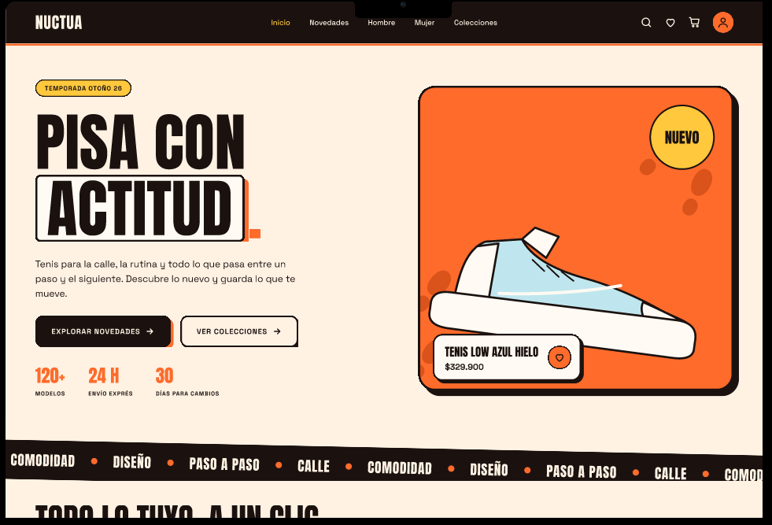
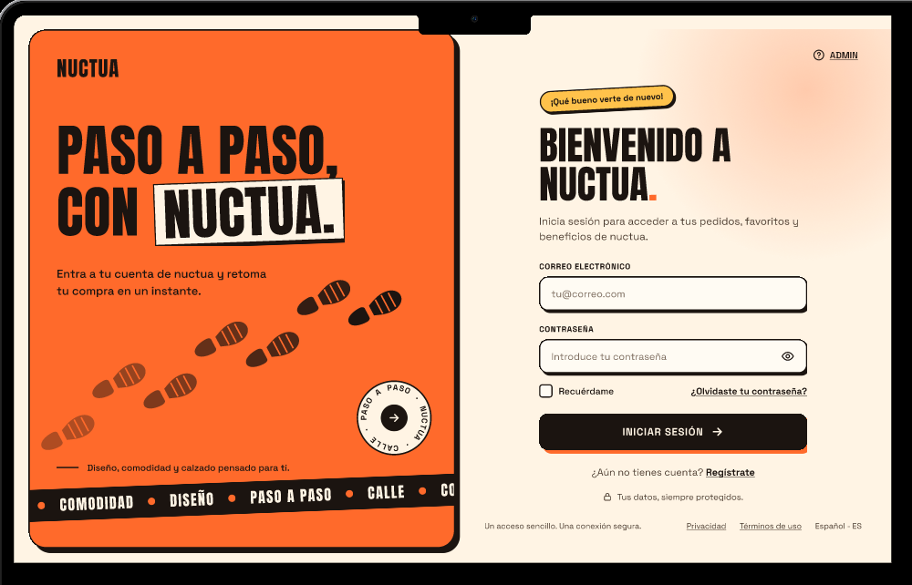
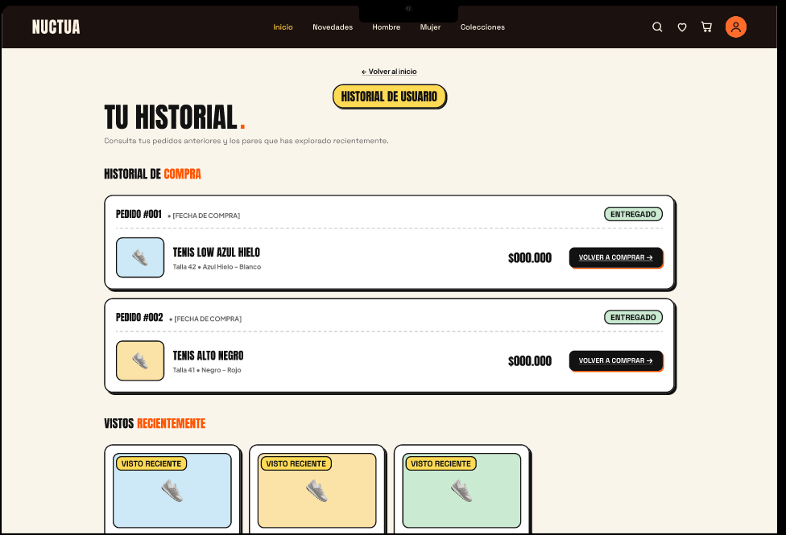
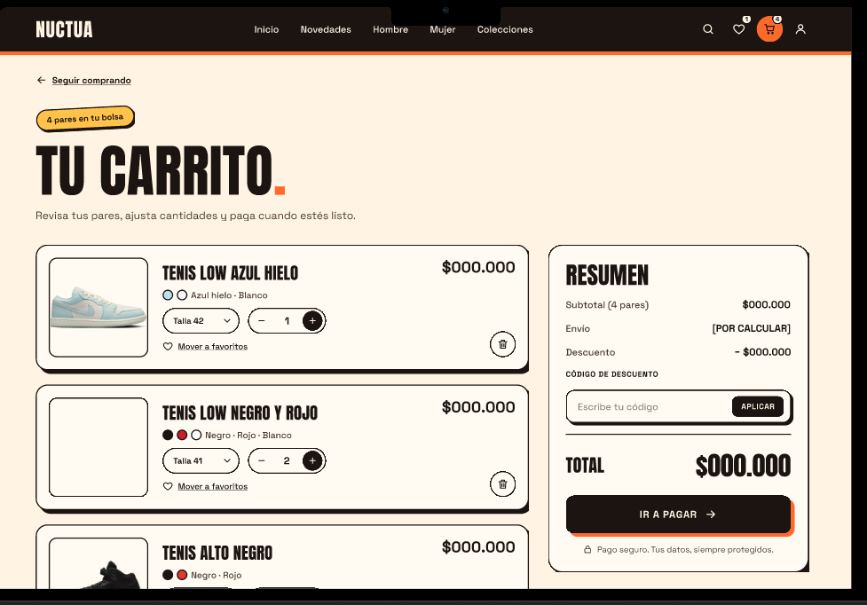
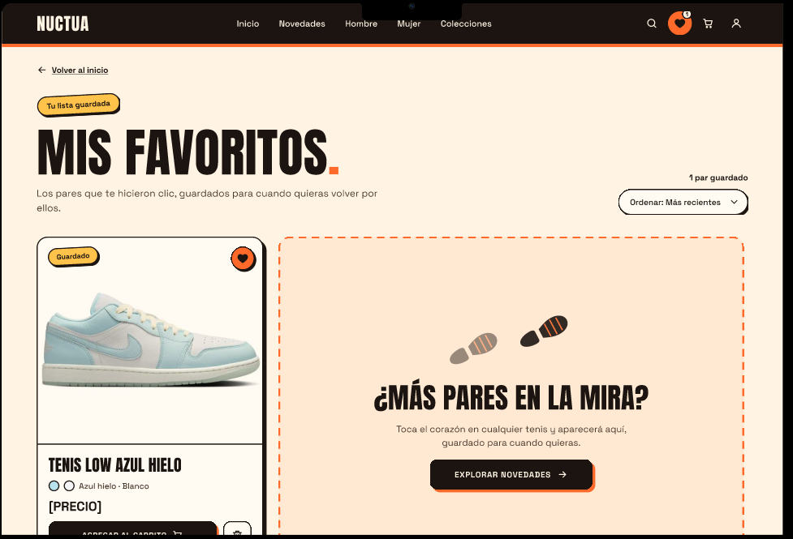

# 👟 Nuctua – Plataforma de Calzado de Lujo

Prototipo de alta fidelidad diseñado en Figma para la aplicación e-commerce de calzado exclusivo **Nuctua**. Este proyecto incluye la experiencia visual e interactiva completa desde el catálogo principal, autenticación de usuarios, selección de favoritos, gestión del carrito y consulta de historiales de compra.

---

## 👥 Integrantes del Equipo
* **Luis Felipe Pachón Negrete**
* **Shaiel Andrés Ricardo Conde**
* **Junior Germán Varilla Teherán**

---

## 🔗 Enlaces del Prototipo en Figma
* 🚀 **Prototipo Interactivo (Modo Presentación):** [Probar prototipo interactivo en vivo](https://www.figma.com/proto/2WViH7QbT6c7dnc49OkTZt/Nuctua-%E2%80%93-Inicio--Registro-e-Historiales?node-id=0-1&p=f&t=vsZJUsitfENYbEmz-0&scaling=scale-down&content-scaling=fixed&page-id=0%3A1&starting-point-node-id=12%3A2455&show-proto-sidebar=1)
* 🎨 **Lienzo de Diseño (Modo Edición):** [Ver lienzo de trabajo en Figma](https://www.figma.com/design/2WViH7QbT6c7dnc49OkTZt/Nuctua-%E2%80%93-Inicio--Registro-e-Historiales?node-id=0-1&t=vsZJUsitfENYbEmz-1)

---

## 📌 Descripción del Proyecto
Nuctua es un prototipo interactivo orientado al comercio electrónico de calzado. Su diseño enfocado en la experiencia de usuario (UX/UI) permite la navegación fluida a través de las funciones esenciales del cliente, optimizando el descubrimiento de productos y la gestión de cuenta.

---

## 🚀 Funcionalidades Principales
1. **Inicio / Catálogo:** Visualización de colecciones de calzado, productos destacados y banners promocionales.
2. **Autenticación (Login):** Pantalla de ingreso y registro de usuario.
3. **Historiales:** Vista consolidada de pedidos y compras realizadas previamente.
4. **Carrito de Compras:** Gestión previa al proceso de checkout.
5. **Favoritos:** Sección para guardar calzado seleccionado por el usuario.

---

## 📸 Capturas de Pantalla

### 1. Inicio y Catálogo


### 2. Autenticación (Login)


### 3. Historial de Compras


### 4. Carrito de Compras


### 5. Seccion de Favoritos


---

## 📁 Estructura del Repositorio
```text
Nuctua-Proyecto/
├── screenshots/
│   ├── inicio.png
│   ├── login.png
│   ├── historial.png
│   ├── carrito.png
│   └── favoritos.png
├── Nuctua.fig
└── README.md